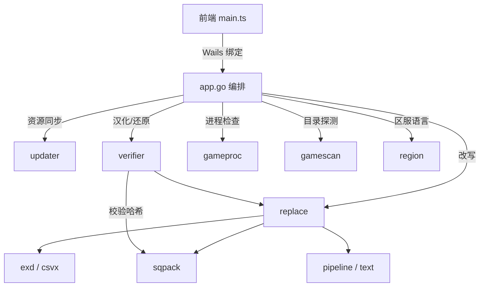

# 汉化器架构说明

Wails v2（Go 1.24 + 原生 TypeScript，无前端框架），产物为单文件 `FFXIVChnTextPatch-SM-v2.exe`。本文以「文件 + 函数名」定位实现。

## 1. 分层

| 层 | 包 | 职责 |
|---|---|---|
| 编排 | `app.go` | Wails 绑定、配置读写、启动探测、并发与取消、日志与进度事件 |
| 流程 | `internal/verifier` | 校验版本与备份状态、生成处理计划、执行与还原 |
| 改写 | `internal/replace` | 把资源写进 sqpack（追加 dat、改 index） |
| 格式 | `internal/sqpack`、`internal/exd`、`internal/csvx` | sqpack 索引/数据包、EXD/EXH、CSV |
| 文本 | `internal/pipeline`、`internal/text` | 译文规则链、`<hex:...>` 标签解析 |
| 资源 | `internal/updater` | 资源下载同步、离线包导入、程序更新检查 |
| 环境 | `internal/gamecfg`、`internal/gameproc`、`internal/gamescan`、`internal/region` | 游戏配置、进程互斥、目录扫描、区服语言映射 |



## 2. 两套云端数据

用途不同，不可混用。

| | 汉化资源 | 官方原版备份 |
|---|---|---|
| 位置 | 仓库 `assets` 分支（孤儿分支，只留最新一次构建） | GitHub Release，tag 即游戏版本号 |
| 内容 | `manifest.json`、`rules.json`、`tables.json`、`rawexd.zip`、`font.zip` | 6 个 sqpack 文件的 zip + `hashes.json` |
| 生成者 | `.github/workflows/sync_assets.yml`：`resource/` 相关文件变动时跑 `scripts/bundle.ts` 并 force push | `.github/workflows/ffxiv_download.yml`：cron `17,47 * * * *` 比对官方版本，未发布则新建 Release |
| 消费方 | `updater.Provision` | `verifier.resolveCloud`（仅国际服）、手动还原的云端下载 |
| 作用 | 提供中文 CSV、字体与规则 | 保证汉化前能拿到当前版本的官方原文件 |

`updater.DefaultNodes` 为 `raw.githubusercontent.com` 直连 + 6 个加速镜像。`Provision` 并发请求 `manifest.json`，首个成功者作为首选节点，后续下载失败按节点顺序回退。

`verifier.GitHubClient` 对直连与全部镜像并发发请求，首个返回合法内容的胜出，避免直连被阻断时等超时。覆盖三类地址：`api.github.com` REST、Release 网页、附件下载；API 阶段限时 6 秒，超时回退网页解析；`ReleaseByTag` 也 API 优先（一次请求带完整附件列表），被限流或阻断才解析网页。只有直连 404 判资源不存在，镜像 404 只代表该节点不支持该路径。

下载偏好与元数据偏好分开记录：`preferredNode` 只存镜像地址；`directFast` 仅在实测直连 ≥1 MiB 且 ≥512 KiB/s 时置位（几十 KB 的 `hashes.json` 不算）。未确认直连够快时，下载候选把直连排最后，`MirrorDownloadURL` 恒返回镜像地址供自更新弹窗使用。

两个 HTTP 客户端（`updater.New`、`verifier.NewGitHubClient`）的 `Transport.Proxy` 取 `netproxy.Func()`，解析顺序：`HTTPS_PROXY`/`HTTP_PROXY`/`ALL_PROXY` → Windows Internet 设置的 `ProxyEnable`/`ProxyServer`/`ProxyOverride` → 直连。注册表 30 秒内最多读一次；`ProxyOverride` 支持 `*`、`<local>`、`*.domain`、`192.168.*`；回环恒直连。仅配 PAC 而无静态代理时按直连（需 `WinHttpGetProxyForUrl`，标准库不具备）。

## 3. 本地数据布局

`resolveResourceDir`（`app.go`）优先使用可写的工作目录 `resource/`、`../resource`、exe 同级 `resource/`；都不存在时依次尝试 exe 目录、用户缓存目录、`LOCALAPPDATA` 下新建。

```text
resource/                 # 可写优先，缺失时从 assets 分支同步
├── rawexd/               # 译文 CSV，7114 个文件
├── font/                 # 字体 tex 与 fdt
├── rules.json            # specialWord（藏宝图别名）、materiaMap（魔晶石属性）
├── tables.json           # folders（14 个文件夹名）、tables（397 张表名）、files（7114 个表键）
├── manifest.json         # 资源构建清单，用于判断是否需要重新同步
└── patched_records.json  # 汉化成功后的索引哈希与版本，用于状态判定

backup/{global|chs|tc|ko}/ # 按区服存放，目录名取 region.Of(lang)
├── 0a0000.win32.{dat0,index,index2}
├── 000000.win32.{dat0,index,index2}
└── meta.json              # 版本号 + 每个文件 SHA256 + 更新时间

config.json               # 游戏目录、语言、目标语言、开关、规则、预设
```

`backup/` 与 `config.json` 和 `resource/` 同级，`patched_records.json` 在 `resource/` 内。macOS 下若 `resource/` 位于缓存目录，`dataRootFor` 把 `backup/` 与 `config.json` 改到 `~/Library/Application Support/FFXIVChnTextPatch`。

6 个受管文件（`verifier.TextFiles` / `FontFiles`）：

- 文本：`0a0000.win32.{dat0,index,index2}`
- 字体：`000000.win32.{dat0,index,index2}`

改写只发生在 `.index`，`index2` 始终为原版，但备份与还原同样覆盖它。游戏目录 `game/sqpack/ffxiv/` 能否写入取决于目录 ACL 与文件状态，不预先探测可写性或文件锁，实际写入失败时直接返回底层系统错误并中止。

## 4. 启动

`GetBootstrap`（`app.go`）两条路径：

1. `updater.HasLocalResource` 为真（`manifest.json`、`tables.json`、`rawexd/` 齐全）：立即返回界面数据，后台 goroutine 跑 `Provision` 比对资源（`resourceSyncOnce` 保证只跑一次），有更新通知前端但不阻塞。
2. 否则：同步执行 `Provision` 并进入准备页，靠 `resource-progress` 事件显示进度。失败时置 `offline = true`，前端显示离线状态并给出导入离线包入口。

无已保存的游戏目录时，界面渲染后在空闲回调里异步探测（`detectGameDir(true)`）。范围：注册表与常见安装路径、各盘符下的固定后缀目录、macOS 的 XIV on Mac / Bottles 候选；排除网络驱动器，避免 `os.Stat` 卡在 SMB 超时。

## 5. 一次汉化的完整链路

入口 `App.StartPatch`，核心 `verifier.Run`。

1. **前置校验**：目录非空、语言可解析、`replaceText || replaceFont` 至少一项、`beginBusy` 互斥；建立可取消的 `patchCtx`。
2. **进程互斥**：官方启动器、第三方启动器、游戏本体均在检测范围；启动器运行时可弹窗强制结束。
3. **区服核对**：`verifier.DetectClientRegion` 看 `0a0000.win32.index` 中是否存在 `exd/addon_0_{chs,ko,tc}.exd` 判国服/韩服/台服，`addon_0_{ja,en,de,fr,cht}.exd` 判国际服；与所选区服不符直接拒绝，防止覆错原文件。
4. **显卡配置**：勾选字体时 `gamecfg.EnsureHighResolutionUiAsset` 把 `FFXIV.cfg` 的 `UiAssetType` 置 1，改动前在同目录生成 `FFXIV.cfg.bak`，已是 1 则不写。
5. **等资源就绪**：`waitResourceReady(patchCtx)` 最多等 30 秒；超时后提示并继续等同步结束（解压会覆盖 CSV，提前开始可能读到半写文件），期间可被「停止」打断。
6. **计算范围**：勾选表转成 `exd/<小写路径>` 集合；`replaceText` 但未选表直接报错。
7. **生成计划**：读 `ffxivgame.ver`，对 6 个文件全量 SHA256（`hashAll`）；国际服查 Release 得 `matched` / `pending` / `localOnly`，非国际服固定 `localOnly`；再判断文本与字体是否原版，为每类文件选定动作。无官方哈希可核对时，统一以 `patched_records.json` 的索引哈希判断「上次是否本工具汉化」：命中则判定为已汉化，未命中则把当前客户端当作汉化基线。
8. **备份保障**：`ensureAllOriginalFilesBackedUp` 单趟确保 6 个文件都有哈希校验过的原版备份，缺的从游戏目录提取（国际服还可从云端下载）。复制先写临时文件、边写边算 SHA256，一致才 rename，校验失败时目标文件保持原样。
9. **执行**：`prepareTextFiles` / `prepareFontFiles` 按动作还原原文件（无需重复校验备份），再调 `applyTextData` / `applyFontData` 改写 sqpack。
10. **收尾**：写 `patched_records.json`（汉化后索引哈希 + 版本），把游戏目录、语言、目标语言、开关、规则写回 `config.json`。

### 计划动作

| 动作 | 含义 | 前提 |
|---|---|---|
| `patch` | 当前是原版，直接改写 | `determineOriginal` 判定为原版 |
| `restorePatch` | 当前已汉化，先从本地备份还原再改写 | 备份与当前版本一致且文件齐全 |
| `downloadRestorePatch` | 本地无备份，从云端取原文件还原后改写 | 仅国际服，且云端已备份当前版本 |
| `skip` | 该组文件不需要处理 | 未勾选或无需变更 |
| `none` | 未启用 | — |

判定不出是否原版时直接报错，提示先用官方启动器修复。**每次汉化都是「先回到原版，再追加」，不是叠加**，这也是重复汉化不会让 dat0 无限膨胀的原因。

### 用户确认

只改文本、不换字体、字体仍是原版、且不是国服时，通过 `Config.ConfirmFont` 弹窗提示「可能看不到中文」。国服不弹。

## 6. 二进制改写

### 文本

结构前提：每张表由 `exd/<表名>.exh` 描述列偏移、类型与分页，数据按「页 + 语言」拆成 `exd/<表名>_<页号>_<语言>.exd`，`root.exl` 列出全部 EXH。

`replace.ReplaceEXDF` 流程：

1. 打开 `0a0000.win32.index`，读 `root.exl` 得到全部 EXH 与表清单。
2. 每张表读 `resource/rawexd/**/*.csv`，结构为 4 行头加数据行：

   ```text
   key,0,2,8,9                          # 列偏移索引（key 固定首列）
   #,Singular,Plural,Description,Name    # 字段名，csvx 当注释跳过
   offset,0,4,8,12                      # EXD dataset 内偏移
   Int32,String,String,String,String     # 类型
   0,,,,                                # 数据
   ```

3. 逐个 dataset 取原文与 CSV 译文，按所选规则链变换（`pipeline`），再经 `text.ParseTargetString` 编码：UTF-8 直写，`<hex:...>` 解成原始字节（游戏控制码）。
4. 重建 EXDF，打包为 sqpack 二进制块，追加到 `0a0000.win32.dat0` 末尾。
5. 新偏移批量写回 `.index`。

两阶段提交：循环中只写 dat 并收集 `(entry, offset)`，结束后统一 `dat.Sync()` → 逐个 `WriteDataOffset` → `index.Sync()`。索引在任何时刻只指向已落盘数据，中断只留下无引用的 dat 空洞，不会产生坏索引。

### 字体

`resource/font/*.tex` 走 `sqpack.BuildTexBlock`（Type 4 纹理块），`*.fdt` 走 `BuildBinaryBlock`（Type 2 二进制块），追加到 `000000.win32.dat0` 并更新 `.index`。`BuildTexBlock` 只支持单 mip，多 mip 显式报错。

### 规则链

`pipeline` 把规则做成可组合的 `Rule`，前端开关直接对应 `ID()`：

| ID | 作用 |
|---|---|
| `treasure_map_alias` | 藏宝图等级标注，数据来自 `rules.json` 的 `specialWord` |
| `materia_stat_suffix` | 魔晶石属性后缀，数据来自 `rules.json` 的 `materiaMap` |
| `opencc_s2tw` | 简体转臺灣繁體 |
| `ktg_cheat` | 将字库改为纯数字（特殊玩法） |

规则只作用于 `<hex:...>` 之外的普通文本。

## 7. 客户端状态判定

`App.CheckClientStatus` 按优先级返回，命中即返回：

| 顺序 | 条件 | 结果 |
|---|---|---|
| 0 | 实际区服与所选区服不一致 | `mismatch` |
| 1 | `patched_records.json` 中目录、区服一致，且索引哈希与当前文件全中（版本号仅用于展示） | `patched` |
| 2 | 非国际服（未被第 1 级命中） | `unsupported` |
| 3 | 本地备份版本与当前一致 | 哈希一致 `original`，否则 `modified` |
| 4 | 国际服且云端 Release 存在，4 秒内取到 `hashes.json` | 一致 `original`，否则 `modified`（不穿透） |
| 兜底 | 以上均不命中 | `original`（描述为「未检测到已知修改」） |

第 2 级是硬性约束：非国际服没有官方哈希，本地备份也不能当官方基准，只能报「不支持检测」。兜底属于 fail-open，因此文案写「未检测到已知修改」而非「官方原版」。

## 8. 还原

`App.RestoreOriginal` → `verifier.Restore`：

- 非国际服：必须有版本一致的本地备份，否则报错并建议用官方启动器修复，不尝试下载。手动还原还要求 `patched_records.json` 的索引哈希与当前文件一致——版本号相同不足以证明备份未过期，否则旧备份会覆盖热修后的新内容。
- 国际服：备份无效时可从 Release 下载对应版本原文件。
- 逐文件比对哈希，只覆盖真正被改动的文件，`index2` 同样参与比对。
- 成功后清除该游戏目录在 `patched_records.json` 中的记录，其余目录保留。

自动还原只在汉化确实写入过数据后触发（`patchWroteData`）；写入前的错误（资源缺失、备份校验失败等）直接返回，不动客户端，避免把上一次成功的汉化静默回滚。还原可被取消，但用户主动中止的分支保证恢复跑完。

## 9. 区服与语言

`internal/region` 是所有区服逻辑的分发点：

- `ParseLanguage`：接受 `GLOBAL/GL`、`JA/EN/DE/FR`、`CHS/CN/ZH/ZH-CN`、`TC/CHT`、`KO`，大小写与空白不敏感。
- `Of`：`CHS→chs`、`TC→tc`、`KO→ko`，其余归 `global`。
- `TargetLanguagesFor`：国际服一次处理 `JA, EN, DE, FR`，前端可勾选子集；国服/台服/韩服固定单一语言。

备份目录按区服而非语言划分，国际服四种语言共用同一份原版备份。两类区服在读版本号、全量 SHA256、汉化、本地备份与还原上完全一致，差异只在云端是否提供该版本的权威原文件：

| 能力 | 国际服 | 国服 / 韩服 / 繁中服 |
|---|---|---|
| 云端原文件下载 | 是（Release tag 即版本号） | 不提供 |
| 原版状态检测 | 云端 `hashes.json` 权威比对 | 不提供（无官方哈希） |
| 还原来源 | 本地备份，无效时云端下载 | 仅本地备份，且要求当前仍是本工具汉化产物 |
| 基线来源 | 云端哈希核对过的原版 | 当前客户端文件（靠 `patched_records.json` 识别已汉化） |

非国际服汉化前会在日志提示「将以当前客户端文件作为官方原版基线建立备份」；若检测到仍是上次汉化状态但备份已丢失，拒绝继续，不会把汉化结果再备份一遍。

## 10. 离线包

`updater.ImportOffline` 支持 zip 或目录，自动识别公共前缀，内层 `rawexd.zip` / `font.zip` 自动解压：

- **先暂存再切换**：展开到资源目录同卷的 `.resource-import-*` 临时目录，校验通过才替换 `resource/`；失败时现有资源保持原样。
- **校验**：暂存目录至少要有 `rawexd/*.csv`；包内自带 `manifest.json` 时，两个 zip 的实际 SHA256 必须与清单一致。
- **保留未提供文件**：切换后把旧目录存在、包内没有的文件（如 `rules.json`）补回。
- 缺 `tables.json` 从 CSV 目录生成；缺 `manifest.json` 调 `generateFallbackManifest`——有 zip 时直接取两个 zip 的 SHA256（与发布清单同值域），只有解压目录时用 `LocalFingerprint`（`相对路径:sha256` 排序拼接后再取 SHA256），仅作本地标识，不写入 `rawexd.sha256`，不干扰云端同步判断。
- 导入后清除离线标记并标记资源就绪。

CI 只发布 exe 与 macOS 包（`build_patcher.yml`），仓库不发布离线资源包，fallback 分支在实际使用中很常见。

资源完整性由 `modulesComplete` 判定：`rawexd`、`rules`、`tables` 按清单哈希比对；字体不复用清单记录，对每个 `.fdt`/`.tex` 重新算 SHA256（49 个文件约 17MB），外部改动或写坏时能触发重新下载。

## 11. 构建与发布

- 本地构建：根目录 `pnpm run build`（`scripts/build.ts`）先构建前端产物，再 `go build` 产出根目录 exe。改完代码必须跑一次。
- `build_patcher.yml`：打 `patcher-v*` tag 或手动触发，跑 `go test ./...` 后构建 Windows exe 与 macOS 包。
- `sync_assets.yml`：`resource/rawexd`、`resource/font`、`rules.json`、`tables.json`、`scripts/bundle.ts` 变动时重新打包并更新 `assets` 分支。
- `ffxiv_download.yml`：每半小时检查官方版本，未发布则新建 Release 并附 6 个原文件 zip 与 `hashes.json`。

## 12. 已知行为与限制

- `preset` 为 `custom` 时不持久化：`selected` 是前端内存中的 `Set`，重载后回退 `recommended`。
- `resourceHash` 未在界面展示：`updateResourceBuildMeta` 忽略 hash 参数，仅显示构建时间。
- 表列表 7114 项，勾选与搜索都整表重建 DOM，无防抖，全展开时明显卡顿。
- `CheckAppUpdate` 只返回版本信息，前端提示并打开 Release 页，不自动安装；弹窗另提供「镜像下载」。只有 `patcher-v*` 参与版本比较——仓库里还有 `v2.20.0`、`v2.18.x` 等旧版 Java 汉化器的 tag，按「形如 x.y.z」采信会误判为更新版本。降级到网页列表时按 `releases/download/<tag>/FFXIVChnTextPatch-SM-v2.exe`（macOS 为 `-macOS.zip`）直接拼地址。

## 13. 代码索引

| 想改什么 | 去哪 |
|---|---|
| 界面、交互、事件订阅 | `frontend/src/main.ts`、`frontend/index.html`、`frontend/src/style.css` |
| Wails 绑定、配置、启动流程 | `app.go` |
| 汉化流程与状态判定 | `internal/verifier/verifier.go` |
| 二进制改写 | `internal/replace/replace.go` |
| sqpack 索引与块打包 | `internal/sqpack/index.go`、`dat.go`、`block.go` |
| EXD / EXH 解析 | `internal/exd/exdf.go`、`exhf.go` |
| CSV 读写 | `internal/csvx/csv.go` |
| 译文规则 | `internal/pipeline/rules.go`、`pipeline.go` |
| `<hex:...>` 处理 | `internal/text/hex.go` |
| 资源同步、离线包、更新检查 | `internal/updater/` |
| 区服语言 | `internal/region/region.go` |
| 进程互斥、目录探测 | `internal/gameproc/`、`internal/gamescan/scan.go` |

## 14. 测试

`go test ./...` 覆盖各包单测与端到端对拍。`internal/golden` 是最有价值的保障：`internal/sqpack/testdata/golden_exdf_hashes.json` 记录了旧版 Java 汉化器对国际服原版执行「替换字体 + 替换文本（JA, EN）」后导出的 29036 个 EXD 逐文件 SHA256；测试重跑同样流程并逐字节抽样比对，任何影响输出字节的改动都会被拦住。

该测试处理约 400MB 数据，`-short` 会跳过。原版样本查找顺序：`GOLDEN_SOURCE_DIR` → `testdata/golden_source` → 仓库外层 `backup/global`；都没有时自动从 GitHub Release 下载到 `testdata/golden_source`，首次运行较慢，之后走缓存。
